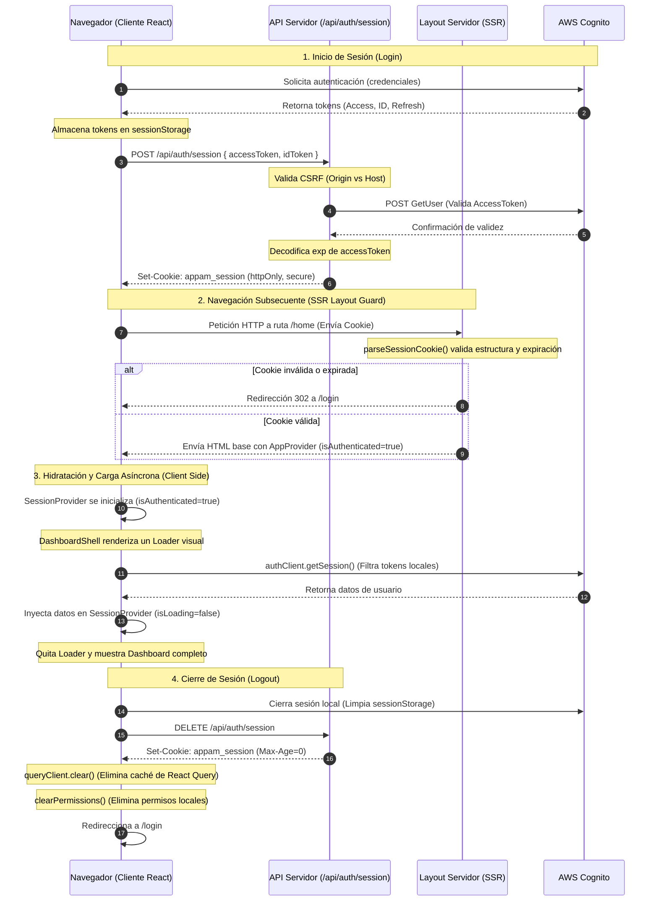

# Arquitectura de Seguridad de Autenticación y Autorización

Este documento describe la arquitectura técnica de seguridad implementada en la aplicación, abarcando el flujo de autenticación, la gestión de autorización, el rol de los React Providers, el uso de Cookies seguras, la integración con AWS Cognito y el ciclo de vida completo de la sesión.

---

## 1. Arquitectura de Autenticación (Authentication)

La autenticación garantiza la identidad de los usuarios que acceden al sistema. Se rige por los siguientes principios:

- **Proveedor de Identidad Primario (IdP):** AWS Cognito es la única fuente de verdad para validar credenciales y emitir tokens de seguridad (Access Token, ID Token, Refresh Token).
- **Almacenamiento Volátil en el Cliente:** Para mitigar riesgos de secuestro de sesión a largo plazo, los tokens emitidos por Cognito se almacenan temporalmente en `sessionStorage` en lugar de `localStorage`. La sesión se destruye automáticamente al cerrar la pestaña o el navegador.
- **No Confianza Implícita en Cookies:** El servidor no confía en la simple presencia de una cookie para autorizar operaciones sensibles; en su lugar, se requiere validar los tokens JWT directamente en la API de la aplicación o contra Cognito.

---

## 2. Arquitectura de Autorización (Authorization)

La autorización controla el acceso a recursos específicos según el perfil del usuario.

- **Desacoplamiento Completo:** La autenticación (Cognito) y la autorización (Permisos) están separadas a nivel de lógica y estado.
- **Servicio de Permisos:** El cliente consulta el servicio backend (`permissionService`) para obtener los permisos y el menú del usuario basándose en su sesión autenticada.
- **Estado Independiente:** `PermissionProvider` maneja de forma aislada el estado de los permisos de control de acceso basado en roles (RBAC) y la estructura del menú, limpiándolo de forma automática e inmediata al detectar una sesión desautenticada.

---

## 3. Jerarquía y Optimización de Providers

Para optimizar el tamaño de descarga del JavaScript inicial (Initial JS Bundle) y prevenir hidrataciones innecesarias en páginas públicas, los Context Providers de React están segregados en dos niveles:

### A. Providers Globales (`RootLayout`)

Registrados a través de `GlobalProvider` en el layout raíz de la aplicación.

- `ThemeProvider`: Controla la persistencia visual del tema (Dark Mode/Light Mode).
- `Toaster`: Contenedor para notificaciones flotantes en el UI.

### B. Providers de Aplicación (`(app) Layout`)

Registrados a través del `AppProvider` dentro del Route Group `(app)`. Solo se cargan en vistas autenticadas (`(dashboard)`) y de login/registro (`(auth)`).

- `QueryProvider`: Contexto de React Query para gestión de estado y peticiones.
- `SessionProvider`: Controla el estado y el ciclo de vida de la autenticación de la sesión.
- `AuthProvider`: Expone los métodos transaccionales para iniciar y cerrar sesión (`signIn`, `signOut`).
- `PermissionProvider`: Controla los roles, permisos y nodos visibles del menú para el usuario.

---

## 4. Gestión de Cookies (`appam_session`)

Para habilitar la protección de rutas mediante Renderizado del Lado del Servidor (SSR), se utiliza una cookie de sesión con una huella mínima de datos.

- **Contenido Reducido:** La cookie únicamente almacena un JSON simplificado para el servidor:
  ```json
  { "isAuthenticated": true, "expiresAt": 1721175600 }
  ```
  _Nunca_ se almacenan tokens JWT ni información sensible del usuario dentro de la cookie para evitar duplicaciones y ataques de robo de sesión a gran escala.
- **Atributos de Seguridad Aplicados:**
  - `httpOnly: true`: Evita la manipulación o lectura del string de la cookie por código JavaScript en el cliente (mitigación frente a XSS).
  - `secure: true` (en producción): Fuerza que la cookie viaje exclusivamente por canales cifrados HTTPS.
  - `sameSite: "lax"`: Proporciona protección ante ataques CSRF en navegaciones externas directas.
- **Verificación de Manipulación:** Al leer la cookie en el servidor (`parseSessionCookie`), si el JSON está corrupto, es inválido o el campo `expiresAt` es inválido (o numéricamente igual a cero), se invalida y se retorna `null`.

---

## 5. Integración y Validación con AWS Cognito

El backend de Next.js realiza la comprobación criptográfica del estado de la sesión:

- Durante el establecimiento de sesión (`POST /api/auth/session`), el servidor recibe el `accessToken`.
- Realiza una validación activa contra el endpoint de AWS Cognito por red llamando al método `GetUser` (`AWSCognitoIdentityProviderService.GetUser`).
- Si Cognito responde afirmativamente, se asegura que el token es válido.
- Posteriormente, se extrae de forma segura el timestamp de expiración (`exp`) del cuerpo del `accessToken` validado (y no del `idToken` sin validar) para determinar el ciclo de vida de la cookie de sesión.

---

## 6. Flujo de Trabajo Completo

El siguiente diagrama detalla la interacción entre el Cliente, el Servidor y AWS Cognito durante la autenticación, carga protegida y cierre de sesión:



---

## 7. Directivas Adicionales de Seguridad

1.  **Content Security Policy (CSP):** Configurada en `next.config.ts` para restringir la ejecución de código no autorizado (`unsafe-inline` minimizado) y delimitar conexiones salientes exclusivamente a dominios conocidos (como los endpoints de Cognito de AWS y las URLs internas de la API).
2.  **Mitigación ante Secuestro de Cookie:** En caso de que se intente inyectar una cookie alterada por un atacante local, el validador SSR descarta el estado si no tiene la fecha de expiración coherente o el formato de cifrado esperado por Cognito.
